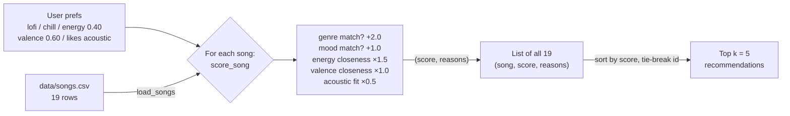

# 🎵 Music Recommender Simulation

## Project Summary

In this project you will build and explain a small music recommender system.

Your goal is to:

- Represent songs and a user "taste profile" as data
- Design a scoring rule that turns that data into recommendations
- Evaluate what your system gets right and wrong
- Reflect on how this mirrors real world AI recommenders

Replace this paragraph with your own summary of what your version does.

---

## How The System Works

### How real recommenders work

From what I have learned, platforms like Spotify and YouTube mix two approaches. **Collaborative filtering** recommends songs that users with similar listening habits liked, and it learns from behavior like plays, skips, likes, saves, and playlist adds without ever looking at the music itself. **Content-based filtering** recommends songs whose attributes, such as genre, mood, tempo, energy, and valence, are close to what a user already likes. At a large scale these systems use both at once and also factor in context like the time of day or the current listening session. A separate ranking step then decides the final order of what the user sees.

My version is a small **content-based** recommender, as there is no data from other users to work with. It scores each song by how well it matches a user's stated taste, with **genre** counting the most, followed by **mood**, and then how close the song's **energy** and **valence** are to what the user wants. I wanted energy and valence to reward closeness to the user's target as opposed to just rewarding higher values. For example, someone who wants calm music with an energy target of 0.3 should get calm songs, and a rule where more energy is always better would push the loudest songs to the top for them instead.

### Features used

**`Song`**

| Feature | Used for |
|---|---|
| `genre` | exact match with the user's favorite genre |
| `mood` | exact match with the user's favorite mood |
| `energy` | closeness to the user's target energy |
| `valence` | closeness to the user's target valence (how happy or dark it sounds) |
| `acousticness` | small bonus based on whether the user likes acoustic music |
| `id`, `title`, `artist` | tie-breaking and display |

I load `tempo_bpm` and `danceability` but do not score them. In this catalog they move almost in step with energy, with correlations of 0.91 and 0.70, so scoring them would end up counting how intense a song is several times over.

**`UserProfile`**

| Field | Meaning |
|---|---|
| `favorite_genre` | e.g. `"pop"` |
| `favorite_mood` | e.g. `"happy"` |
| `target_energy` | 0.0 to 1.0 |
| `target_valence` | 0.0 to 1.0, optional (not scored if omitted) |
| `likes_acoustic` | `True` / `False` |

### Data and main user profile

The starter catalog had 10 songs, and I expanded it to 19 by adding hip hop, metal, country, classical, r&b, edm, reggae, folk, and synthpop songs. Additionally, the new songs bring in moods the starter did not have, like angry, sad, romantic, and nostalgic. The starter's valence only ranged from 0.48 to 0.84, so I made sure to include a few truly sad songs to give valence a wider range of 0.18 to 0.88.

The main profile I will test with is a lofi listener who wants calm, mellow, acoustic music:

```python
user_prefs = {
    "favorite_genre": "lofi",
    "favorite_mood": "chill",
    "target_energy": 0.40,
    "target_valence": 0.60,
    "likes_acoustic": True,
}
```

I checked this profile against an opposite rock and intense profile, and the two separate clearly. The top song for each scores about 4.6 points higher than its last song, and the song one profile ranks last tends to be near the top for the other.

### Algorithm recipe

**Scoring rule** (one song, max 6.0 points):

| Component | Points |
|---|---|
| Genre matches | +2.0 |
| Mood matches | +1.0 |
| Energy | 1.5 × (1 − \|song.energy − target_energy\|) |
| Valence | 1.0 × (1 − \|song.valence − target_valence\|) |
| Acoustic fit | 0.5 × acousticness if `likes_acoustic`, else 0.5 × (1 − acousticness) |

I gave genre more weight than mood as a person's genre taste tends to stay fairly stable, while the mood they want depends a lot on the moment.

**Ranking rule** (whole catalog): The system scores every song, sorts them from highest to lowest, breaks any ties by `id`, and returns the top `k` songs along with the reasons behind each score.



### Biases I expect

I expect this system to over-prioritize genre. A song only gets genre points for an exact label match, so a rock fan gets nothing for a metal song and a pop fan gets nothing for an indie pop song, even though those are close in sound. As the catalog only has one rock song, a rock listener drops from a score of 5.90 for their top pick straight to 3.61 for the next one. This will likely create a filter bubble where a listener keeps getting the same genre, and great songs that match their mood in another genre end up ranked lower.

Mood has the same issue at a smaller scale. A chill listener gets no credit for relaxed or focused songs, which in practice feel very close to chill. I also noticed that genre and mood end up deciding most of the ranking. When I took away the genre and mood matches, the top five scores were all between 2.73 and 2.88, so energy, valence, and acousticness barely separate songs on their own.

The profile itself is also narrow, as it only allows one favorite genre and one favorite mood and does not change with context. Someone who studies to lofi and works out to rock would only ever be served one side of their taste. Overall, the catalog is small and I wrote the labels and values myself, so the results reflect my own reading of each song's genre and mood.

---

## Getting Started

### Setup

1. Create a virtual environment (optional but recommended):

   ```bash
   python -m venv .venv
   source .venv/bin/activate      # Mac or Linux
   .venv\Scripts\activate         # Windows

2. Install dependencies

```bash
pip install -r requirements.txt
```

3. Run the app:

```bash
python -m src.main
```

### Running Tests

Run the starter tests with:

```bash
pytest
```

You can add more tests in `tests/test_recommender.py`.

---

## Sample Recommendation Output

Output of `python -m src.main` with the default pop/happy profile:

```
Loaded songs: 19

User profile: favorite_genre=pop, favorite_mood=happy, target_energy=0.8
============================================================
Top recommendations
============================================================

1. Sunrise City by Neon Echo  [pop / happy]
   Score: 4.47
     - genre match (+2.0)
     - mood match (+1.0)
     - energy 0.82 vs target 0.80 (+1.47)

2. Gym Hero by Max Pulse  [pop / intense]
   Score: 3.30
     - genre match (+2.0)
     - energy 0.93 vs target 0.80 (+1.30)

3. Rooftop Lights by Indigo Parade  [indie pop / happy]
   Score: 2.44
     - mood match (+1.0)
     - energy 0.76 vs target 0.80 (+1.44)

4. Neon Heartbreak by Static Bloom  [synthpop / sad]
   Score: 1.50
     - energy 0.80 vs target 0.80 (+1.50)

5. Concrete Crown by Block Theory  [hip hop / confident]
   Score: 1.47
     - energy 0.78 vs target 0.80 (+1.47)
```

**Screenshot or video** *(optional)*: <!-- Insert a screenshot or demo video link here -->

---

## Experiments You Tried

Use this section to document the experiments you ran. For example:

- What happened when you changed the weight on genre from 2.0 to 0.5
- What happened when you added tempo or valence to the score
- How did your system behave for different types of users

---

## Limitations and Risks

Summarize some limitations of your recommender.

Examples:

- It only works on a tiny catalog
- It does not understand lyrics or language
- It might over favor one genre or mood

You will go deeper on this in your model card.

---

## Reflection

Read and complete `model_card.md`:

[**Model Card**](model_card.md)

Write 1 to 2 paragraphs here about what you learned:

- about how recommenders turn data into predictions
- about where bias or unfairness could show up in systems like this


